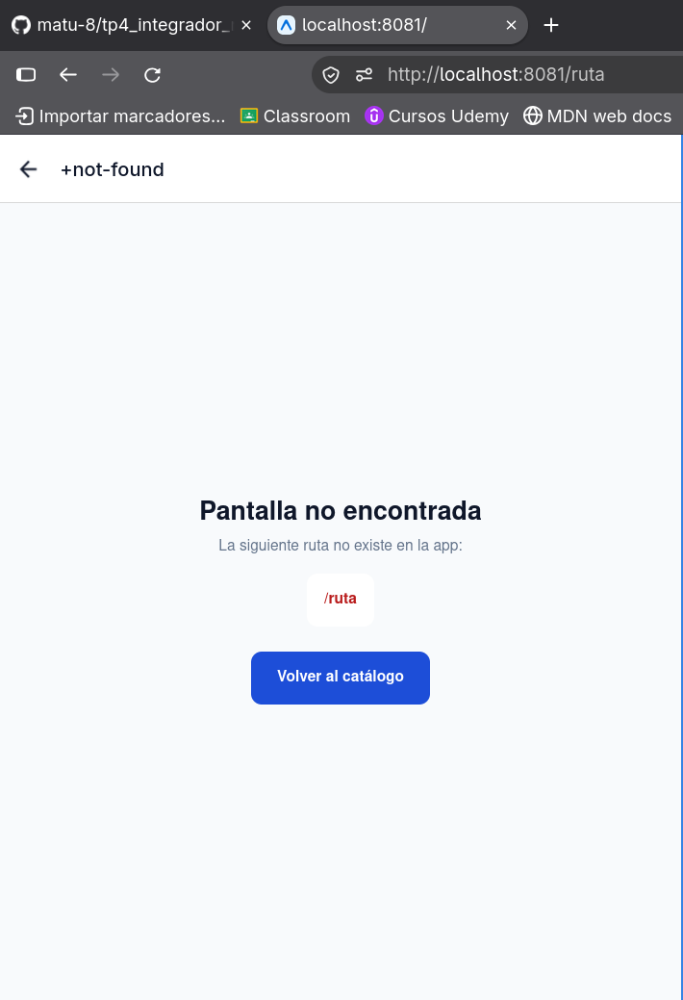

# RESPUESTAS.md — TP N° 4 "Biblioteca IPF"

Alumno/a: Matías Agüero
Fecha de entrega: (completar)
SDK de Expo: 58 (`expo ~58.0.26`, `expo-router ~58.0.32`, React 19.3, React Native 0.88)

## Cómo leer este documento

Las respuestas se apoyan en el código del repositorio (`biblioteca-ipf/src`). Las rutas de archivo son relativas a `src/` y los números de línea son **orientativos**: después de los últimos cambios conviene buscar el símbolo citado si no coinciden exactamente.

No quedan marcas de diferencia: las diez filas del cuadro siguiente están corregidas en el código.

Cuando una respuesta cuenta qué pasa en el teléfono, lo explica con palabras simples. La única captura pedida es la de la página no encontrada, en la Parte F.

### Estado de los puntos que se apartan de la consigna

Las diez filas están corregidas en el código y las respuestas que las citan fueron actualizadas.

| # | Estado | Punto | Dónde |
|---|---|---|---|
| 1 | Corregido | `app.json` declara los plugins de `expo-camera` y `expo-notifications`, el texto de propósito, `microphonePermission: false`, `recordAudioAndroid: false` y `blockedPermissions`. | `app.json` |
| 2 | Corregido | La pantalla 404 muestra la ruta inexistente con `usePathname()`. | `app/+not-found.tsx:6, 12` |
| 3 | Corregido | Los dos libros reales están cargados con sus ISBN sin guiones (`9789501296587` y `9788447383160`). | `data/libros.ts:9-23` |
| 4 | Corregido | El escáner usa `usePermiso('camara')` y un guardián `escaneandoRef` con `useRef`; conserva el ingreso manual y la validación del ISBN. | `app/escanear.tsx` |
| 5 | Corregido | El modal muestra "Confirmar" y recién ahí aplica la reserva; "Ir a mis reservas" usa `router.dismissAll()` + `router.navigate('/reservas')`. | `app/reservar/[isbn].tsx` |
| 6 | Corregido | "Entregar al siguiente" consulta `getPermissionsAsync()` al entregar y cae al aviso interno si no hay permiso. | `app/mostrador.tsx` |
| 7 | Corregido | El Stack del Catálogo exporta `unstable_settings = { anchor: 'index' }`. | `app/(tabs)/(catalog)/_layout.tsx` |
| 8 | Corregido | La validación del ISBN del detalle ocurre antes de cargar el catálogo. | `app/(tabs)/(catalog)/libro/[isbn].tsx` |
| 9 | Corregido | `Mis reservas` muestra el estado del permiso de notificaciones y ofrece "Activar notificaciones" o "Ir a Ajustes". | `app/(tabs)/reservas.tsx` |
| 10 | Corregido | AsyncStorage persiste préstamos, listas, avisos e identificadores de notificación; al iniciar se cancelan las notificaciones huérfanas y no se muestra la app vacía. | `context/BibliotecaContext.tsx`, `lib/notificaciones.ts`, `components/NavegadorBiblioteca.tsx` |

---

# Parte B · Estado, efectos y renderizado

## B1. El ciclo de vida de `useLibros`

Código: `hooks/useLibros.ts:12-51`.

### a) Render por render

**Caso éxito.** Los estados iniciales son `libros = []`, `cargando = true`, `error = null`.

| Render | Valores | Qué lo provoca |
|---|---|---|
| 1 | `libros = []`, `cargando = true`, `error = null` | Montaje del Catálogo. |
| (sin render) | Igual | El efecto arranca (`:22`) y llama `setCargando(true)` y `setError(null)` (`:26-27`). Son los mismos valores que ya hay, así que React no vuelve a renderizar. Dispara `obtenerLibros()`, que tarda 800 ms. |
| 2 | `libros = [15+ libros]`, `cargando = false`, `error = null` | Llega la respuesta: `setLibros(datos)` y `setCargando(false)` (`:32-33`). En React 18 y 19 los dos `setState` se agrupan, entonces es un solo render. |

Total: 2 renders.

**Caso falla y "Reintentar".**

| Render | Valores | Qué lo provoca |
|---|---|---|
| 1 | `[]`, `cargando = true`, `error = null` | Montaje. |
| 2 | `[]`, `cargando = false`, `error = "No se pudo conectar..."` | `obtenerLibros()` lanza el error (1 de cada 5 veces); entra al `catch` (`:35-39`). |
| 3 | `[]`, `cargando = false`, `error = "No se pudo conectar..."` | La persona toca "Reintentar": `reintentar()` incrementa `reintentarContador` (`:19`). Los valores visibles no cambian todavía. |
| (sin render) | | El contador cambió, así que React ejecuta la limpieza del efecto anterior (`cancelado = true`) y vuelve a correr el efecto. Este llama `setCargando(true)` y `setError(null)`. |
| 4 | `[]`, `cargando = true`, `error = null` | Los dos `setState` del efecto, agrupados. |
| 5 | `[libros]`, `cargando = false`, `error = null` | Llega la respuesta. Si falla otra vez, es igual al render 2. |

Nota: entre el render 3 y el 4 hay un instante en el que la pantalla sigue mostrando el error aunque el pedido ya está por arrancar. Es imperceptible, pero existe.

### b) ¿Se desmonta el Catálogo?

Lo que se espera, según cómo está armada la navegación:

- Las tabs vienen de `expo-router/js-tabs` (`(tabs)/_layout.tsx:1`). Una tab ya visitada sigue montada cuando la persona cambia a otra. Al pasar a "Mis reservas" el Catálogo no se desmonta, y la limpieza no corre.
- Al abrir un detalle, `router.push('/libro/...')` agrega la pantalla al Stack del Catálogo (`(catalog)/_layout.tsx`). El Catálogo queda debajo, montado. Tampoco corre la limpieza.

La limpieza de `useLibros` (`:45-47`) corre en estas situaciones reales:

1. Cuando `reintentarContador` cambia: React ejecuta la limpieza de la ejecución anterior antes de la siguiente. Es el caso más frecuente.
2. Cuando el componente que llama a `useLibros()` se desmonta de verdad. En el detalle y en el modal de reserva pasa al volver atrás (se saca la pantalla del stack). En el Catálogo, que es la raíz de su Stack y de la tab, prácticamente solo pasa al cerrar la app o en un Fast Refresh.

Consecuencia de diseño: `useLibros()` se llama en seis pantallas (Catálogo, detalle, reservar, reservas, mostrador y escáner) y cada una tiene su propio estado y su propio pedido. Detalle y reservar se desmontan y se vuelven a montar al entrar y salir, así que vuelven a pedir el catálogo cada vez (800 ms de espera y 20% de probabilidad de error en cada entrada).

### c) ¿Por qué no se puede pasar una función `async` a `useEffect`?

Una función `async` siempre devuelve una `Promise`. `useEffect` espera que el callback devuelva `undefined` o una función de limpieza. Si devuelve una `Promise`, React la interpreta como limpieza, advierte en desarrollo y, al intentar llamarla, falla (una `Promise` no es invocable). Además, la limpieza tiene que ser síncrona.

Cómo lo resolví (`useLibros.ts:23-47`): el efecto es síncrono; adentro declaro `async function cargar()` y la llamo sin esperar (`:43`). El efecto devuelve una función de limpieza síncrona que marca `cancelado = true`.

### d) ¿Cómo implementé `reintentar`?

`reintentar` (`:18-20`) incrementa un contador de estado, `reintentarContador`. Ese contador está en el array de dependencias del efecto (`:48`). Cuando cambia, React corre la limpieza del efecto anterior y ejecuta el efecto de nuevo, que repite el pedido.

¿Por qué un contador y no otro valor?

- `error`: el efecto mismo lo pone en `null` (`:27`), así que usarlo como dependencia crearía un ciclo. Además, si dos errores seguidos tienen el mismo texto, `Object.is` los ve iguales y el efecto no volvería a correr.
- `cargando`: también lo modifica el efecto; mismo problema de ciclo.
- Un contador siempre cambia al incrementarse, no lo toca el efecto y no tiene otro significado.

## B2. La condición de carrera del buscador

Código: `app/buscar.tsx:25-64`.

En mi código hay dos mecanismos:

- Un **debounce** de 300 ms: el efecto (`:57-64`) arma un `setTimeout` y su limpieza lo cancela.
- Un **contador de pedidos** `peticionActual` (`useRef`, `:25`). Cada llamada a `ejecutarBusqueda` incrementa el contador y recuerda su número (`:28-29`). Al llegar la respuesta, solo se usa si el número sigue siendo el actual (`:45` y `:50`).

Por el debounce, en mi app el pedido de "bor" del enunciado nunca se hace (se cancela a los 200 ms). Completo la tabla con ese comportamiento real y agrego qué pasaría con el pedido si se hubiera hecho:

| Momento | Qué pasa | Sin limpieza: qué se ve | Con tu código: qué se ve |
|---|---|---|---|
| t = 0 ms | Escribe "bor" → se pide `buscarLibros("bor")`, que tarda 1.400 ms. | Pedido #1 en vuelo. Spinner. | El input dice "bor". Se arma un temporizador de 300 ms. Todavía no hay pedido. |
| t = 200 ms | Escribe "borges" → se pide `buscarLibros("borges")`, que tarda 300 ms. | Pedido #2 en vuelo. | El input dice "borges". La limpieza del efecto cancela el temporizador de "bor" (ese pedido nunca sale). Se arma uno nuevo para t = 500. |
| t = 500 ms | Llega la respuesta de "borges". | Se ven los resultados de "borges" (correcto, por casualidad). | El temporizador dispara: `setParams({ q: 'borges' })` y se pide "borges" (id 1). Spinner. La respuesta llega entre t ≈ 800 y t ≈ 2.000. |
| t = 1.400 ms | Llega la respuesta de "bor". | **Bug**: pisa el estado. El input dice "borges" y la lista muestra los resultados de "bor". | No llega nada de "bor". Si ese pedido hubiera salido sin debounce (id 1) y "borges" fuera el id 2, `peticionActual.current` valdría 2 y la respuesta de "bor" se descartaría en `:45`. |

### a) ¿Qué hace la limpieza del efecto?

Corrección importante: en mi código la limpieza del efecto **no** descarta la respuesta vieja. Solo hace `clearTimeout(temporizador)` (`:63`), es decir, evita que el pedido de un texto intermedio llegue a salir.

Se ejecuta justo antes de que el efecto vuelva a correr (cuando cambia `texto`) y al desmontar la pantalla.

Quien descarta la respuesta atrasada es la comparación del contador (`:45` y `:50`). Esa comparación, no la limpieza, cubre el caso de un pedido que ya salió y es superado por otro.

### b) La propuesta `if (texto === q) setResultados(datos)` dentro del `.then()`

No funciona. Una función guarda las variables del render en que fue creada (clausura). El `.then()` que se crea al ejecutar el efecto "ve" el valor de `q` de **ese** render, no el valor actual. `texto` (lo que se buscó) y `q` (lo que la clausura guardó) vienen del mismo render, por lo que son iguales siempre y la condición es siempre verdadera. El `if` nunca descarta nada.

Para comparar contra el valor actual hace falta algo que no esté atado a un render: un `useRef` (lo que hice con `peticionActual`) o una limpieza que marque el pedido como cancelado.

### c) URL y botón atrás mientras se escribe

`router.setParams` (`:59`) reemplaza los parámetros de la pantalla actual: la URL pasa a `/buscar?q=...` sin agregar entradas al historial. El botón atrás vuelve al Catálogo con un solo toque, sin importar cuántas letras se escribieron.

Con `router.push` cada cambio (ya con debounce, uno por pausa) apilaría una nueva pantalla `/buscar?q=...`. El botón atrás pasaría por cada búsqueda intermedia, una por una, antes de volver al Catálogo. Habría muchas copias de la misma pantalla en memoria.

Dos observaciones honestas sobre mi implementación:

- El texto del buscador vive en `useState` (`:20`) y se copia a la URL; la URL se lee solo al montar. Si llega un deep link a `/buscar?q=otro` con la pantalla ya abierta, el campo sigue mostrando el texto anterior. La URL es un espejo, no la fuente de verdad.
- Con el campo vacío el efecto igual llama `setParams({ q: '' })` a los 300 ms, y la URL queda como `/buscar?q=`.

## B3. Mutar o reemplazar

### a) La persona toca "Anotarme" tres veces

El texto sigue mostrando `Personas en espera: 0`. `anotarme()` hace `espera.encolar('Ana')`, que muta el objeto guardado en el estado, pero no llama a ningún `setState`. React no sabe que algo cambió y no vuelve a renderizar. El objeto interno sí tiene 3 elementos; la pantalla no lo refleja.

### b) El número "salta" a 3 al escribir en un `TextInput`

Escribir en un `TextInput` controlado cambia un estado, eso provoca un render y, en ese render, `espera.tamanio` se vuelve a leer: ahora vale 3. La pantalla estaba desactualizada, no el dato.

Un error que aparece "a veces" es peor que uno que aparece siempre porque:

- Depende de renders ajenos al problema (otro estado, el teclado, el padre), así que no se puede reproducir con un procedimiento fijo.
- Un error constante se ve la primera vez que se prueba; uno intermitente pasa las pruebas y falla en producción.
- La causa (una mutación) está lejos del síntoma (un número viejo en pantalla) y se suele culpar a otra cosa.

### c) Cómo lo resolví en mi Context y alternativas

En `context/BibliotecaContext.tsx` el estado no guarda instancias de `Cola` sino arrays planos: `esperas: Record<string, string[]>` (`:66`). Cuando hay que operar, creo una `Cola` temporal desde el array, opero y guardo una copia nueva con `cola.aArray()`:

```ts
// reservar (:147-151)
const cola = new Cola<string>();
(esperas[libro.isbn] ?? []).forEach((persona) => cola.encolar(persona));
cola.encolar(ALUMNO.identificadorUsuario);
setEsperas((previas) => ({ ...previas, [libro.isbn]: cola.aArray() }));
```

`entregarSiguiente` (`:174-183`) hace lo mismo con `desencolar()`.

| Alternativa | Ventaja | Costo |
|---|---|---|
| **Crear una cola nueva a partir de la anterior** (lo que hago) | El estado es inmutable: React detecta el cambio por referencia. Es simple y funciona con memoización y con React Compiler. | Copia O(n) en cada operación (irrelevante con 1 o 2 personas). La `Cola` es un ayudante descartable: el estado no es una `Cola`, así que las reglas FIFO solo se aplican en las dos funciones que la usan. |
| **Contador de versión** (mutar la `Cola` y subir un número para forzar el render) | Una sola `Cola` real, sin copias. | Oculta una mutación. La referencia del objeto no cambia, así que `React.memo`, las dependencias de hooks y el React Compiler (activado en `app.json`) pueden dejar de ver cambios. Es la causa raíz del problema de B3, solo disfrazada. |
| **`useReducer`** | Centraliza las transiciones (reservar, entregar, devolver) en una función pura y testeable. | Más código. Si el reducer muta la `Cola` en vez de crear una nueva, reaparece el mismo error. |

Un costo adicional de mi solución: `entregarSiguiente` calcula `siguiente` con el `esperas` de la clausura, fuera de `setEsperas`. Si se toca "Entregar" dos veces muy rápido, antes de que React actualice la pantalla, podría entregarse dos veces a la misma persona. En el uso normal se toca una sola vez. Dentro de un `setEsperas((previas) => ...)` funcional ese problema no existiría.

## B4. ¿Dónde vive cada dato?

| Dato | Dónde vive en mi app | Por qué ahí y no en otro lugar |
|---|---|---|
| Texto del buscador | Estado local `texto` en `app/buscar.tsx:20`, copiado a la URL (`q`) con `setParams` (`:59`). | Solo esa pantalla lo usa y cambia en cada tecla, así que no conviene meterlo en el Context (renderizaría a todos los consumidores). La copia en la URL permite un deep link a una búsqueda. Limitación: la URL se lee solo al montar (ver B2c). |
| Préstamos y reservas | Context, `prestamos` (`BibliotecaContext.tsx:64`). | Lo leen y escriben varias pantallas (detalle, reservar, reservas) y tiene que sobrevivir a la navegación. No es un dato de navegación (URL) ni de una sola pantalla. No se persiste: se pierde al cerrar la app. |
| Listas de espera | Context, `esperas` (`:66`), inicializado con `ESPERAS_INICIALES` (`:17-20`). | Las comparten detalle, reservas y mostrador. Observación: la lista inicial está escrita en el archivo del Context y no en `src/data/`. |
| Vistos recientemente | Context, `recientes` (`:65`). | Se escribe desde el detalle y se lee desde el Catálogo: dos pantallas distintas, así que necesita un dueño común. |
| Sesión del personal | Context, `sesionIniciada` (`:63`). | `Stack.Protected` en `NavegadorBiblioteca.tsx:19-26` necesita el valor en el layout raíz, por encima de todas las pantallas. No va en la URL (sería compartible y falsificable) ni en estado local. |
| Ejemplares disponibles de un libro | Se calcula: `libro.ejemplares` menos los préstamos de ese ISBN (`ejemplaresDisponibles`, `:119-125`). No se guarda. | Guardarlo crearía una segunda copia del mismo dato que podría desincronizarse (ver E4d). |
| Estado del permiso de cámara | Sistema operativo. La app lo lee con `useCameraPermissions` dentro de `usePermiso` (`hooks/usePermiso.ts:36`). | El SO es la única fuente de verdad: la persona puede cambiarlo en Ajustes sin que la app lo sepa. La app solo conserva una copia en estado y la relee al volver al primer plano (`:72-88`). |
| Identificador de la notificación programada | Campo `notificacionId` de cada préstamo en el Context (`:26`, `:161-172`). La notificación en sí vive en el programador del SO. | El identificador pertenece a un préstamo (1 a 1) y se necesita para cancelar al devolver o apagar el interruptor. No se persiste (ver D2b). |

**Cuando cambia el `value` del Context, ¿qué componentes se vuelven a renderizar?** Todos los que llaman a `useBiblioteca()`: Catálogo, detalle, reservar, reservas, mostrador, login, `BotonPersonal` y `NavegadorBiblioteca`. Hay un único Context con todo el estado y todas las funciones.

**¿Se re-renderiza el Catálogo al activar un recordatorio en otra pestaña?** Sí. `activarRecordatorio` cambia `prestamos` (`:161-172`), eso cambia el `value` memoizado (`:189-228`) y el Catálogo (que sigue montado debajo de las tabs) vuelve a renderizar aunque solo use `recientes`. No se nota en pantalla, pero ocurre.

**Cómo evitarlo:** dividir el Context por dominio (sesión, préstamos, recientes), separar estado y acciones en dos Contexts, o usar un store con selectores (por ejemplo `useSyncExternalStore` o Zustand).

**¿Vale la pena en una app de este tamaño?** No. Son 15 libros y listas de pocos elementos: el render extra es despreciable. Antes de dividir conviene medir con el Profiler de React DevTools y ver si hay algo lento. Dividir tiene costo de complejidad.

---

# Parte C · Navegación y rutas

Estructura real de navegadores (`NavegadorBiblioteca.tsx`, `(tabs)/_layout.tsx`, `(catalog)/_layout.tsx`):

```
Stack raíz
├── (tabs)  →  Tabs (expo-router/js-tabs)
│              ├── (catalog)  →  Stack: index, libro/[isbn]
│              └── reservas
├── login               (modal, solo sin sesión)
├── mostrador           (solo con sesión)
├── buscar
├── escanear
├── reservar/[isbn]     (modal)
├── permisos/[recurso]  (modal)
└── reserva             (Redirect a /reservas)
```

## C1. La pila en tu app

Lo que sigue es lo que hace el código **hoy**. Cuando difiere de la consigna, lo marco.

| # | Acción | Pilas resultantes |
|---|---|---|
| 1 | Abre la app. | Stack raíz: `[(tabs)]`. Stack de la tab Catálogo: `[index]`. |
| 2 | Toca un libro del Catálogo. | Stack raíz: `[(tabs)]`. Stack de la tab: `[index, libro/[isbn]]`. |
| 3 | Toca "Reservar". | Stack raíz: `[(tabs), reservar/[isbn]]`. Stack de la tab: `[index, libro/[isbn]]` (sin cambios). La reserva ya se registró al abrir el modal. |
| 4 | Toca "Ir a mis reservas". | `irAReservas` (`reservar/[isbn].tsx:19-21`) llama `router.dismissAll()` y después `router.navigate('/reservas')`. Queda el Stack raíz con `[(tabs)]` y la tab "Mis reservas" activa; el modal y el detalle se descartan, así que "atrás" no vuelve a la confirmación. |
| 5 | Toca atrás (Android) desde la lista. | Vuelve a la pantalla anterior a las tabs o sale de la app, porque la confirmación ya no está en la pila. |
| 6 | Toca la tab "Catálogo". | Stack raíz: `[(tabs)]`. Stack de la tab: `[index]`. |

### a) Método del paso 4

Uso `router.dismissAll()` + `router.navigate('/reservas')` (`reservar/[isbn].tsx`). Cumple la intención de A3.5: la reserva se aplica recién cuando la persona toca "Confirmar", el botón "Ir a mis reservas" lleva a `/reservas` y "atrás" no reabre la confirmación. Las otras opciones habrían resultado así:

- **`push('/reservas')`**: agrega una entrada nueva encima de la pila. "Atrás" volvería al modal de confirmación, y una reserva ya hecha se podría "reconfirmar". Es lo que la consigna quiere evitar.
- **`replace('/reservas')`**: reemplaza el modal en el Stack raíz por `/reservas`. Como esa ruta vive dentro de `(tabs)`, que ya está en la pila, existe el riesgo de terminar con una segunda instancia de las tabs en el Stack raíz.
- **`dismissTo('/reservas')`**: descarta pantallas hasta llegar a una entrada existente de esa ruta. Es la opción más quirúrgica: cierra el modal y deja la tab "Mis reservas" activa dentro de las tabs que ya estaban, sin duplicar nada.
- **`dismissAll()` + `navigate('/reservas')`** (la que uso): cierra todas las pantallas presentadas y navega a la tab. El resultado esperado es el mismo que con `dismissTo`, con la diferencia de que también se descarta cualquier otra pantalla modal previa.

El botón "Confirmar" existe y es el único que llama a `reservar(libro)`. Un `useRef` evita confirmar dos veces si la persona toca rápido; la navegación posterior no puede rehacer la reserva.

### b) Paso 6

Con el código actual, la persona ve el Catálogo: después de "Ir a mis reservas" la pila de la tab Catálogo quedó en `[index]`.

Regla general (comportamiento de React Navigation): tocar una tab que ya está activa lleva su Stack a la primera pantalla. Si la persona estuviera en "Mis reservas" y tocara "Catálogo", vería la pantalla donde dejó esa tab (por ejemplo el detalle), porque cada tab conserva su propio Stack. Así funciona React Navigation.

¿Es correcto para esta app? El comportamiento por tab es el estándar y me parece correcto. Ahora, después de reservar, la persona termina en "Mis reservas" y no en el detalle.

## C2. El escáner que dispara de más

Código: `app/escanear.tsx:10-108`.

### a) `router.push` sin protección

`onBarcodeScanned` se dispara muchas veces por segundo mientras el código está frente a la cámara. Cada llamada encola una acción de navegación; sin guardián, cada lectura apilaría una copia del detalle y la persona tendría que tocar atrás N veces. El guardián es `escaneandoRef` (`app/escanear.tsx`), comprobado al entrar a `procesarCodigo` y desactivado apenas se decide navegar al detalle o mostrar un `Alert`.

### b) `useState` o `useRef`

Uso `useRef<boolean>(true)` (`escaneandoRef`). Para esta función conviene `useRef`.

Un `useState` puesto en `false` en el primer escaneo no cambia la variable al instante: React la actualiza en el render siguiente. Los llamados a `procesarCodigo` que ya estaban en camino antes de ese render seguirían leyendo `true` en su clausura y pasarían el guardián; desconectar el handler solo mitigaría el problema después del render. Un `useRef` se actualiza de forma síncrona y no depende del render, así que cierra esa ventana. `useFocusEffect` lo reactiva al entrar a la pantalla y limpia el valor al perder el foco.

### c) `replace` y no `push` para ir del escáner al detalle

Con `replace`, el escáner sale de la pila y el detalle ocupa su lugar: al tocar atrás la persona vuelve a donde estaba antes del escáner. Con `push` (lo que hace mi código, `:47`), atrás vuelve al escáner.

El guardián evita lecturas duplicadas mientras se abre el detalle, pero `useFocusEffect` vuelve a poner `escaneandoRef.current = true` cada vez que la pantalla recupera el foco. Si el libro sigue frente a la cámara, puede leerlo otra vez y abrir otro detalle: escanear → detalle → atrás → escanear → detalle. Una salida posible sería `router.replace`, pero el enunciado pide `push` con guardián, así que se conserva `push` y se documenta el riesgo.

### d) ISBN que no está en el catálogo

Antes faltaba; ahora `procesarCodigo` consulta el catálogo que trae `useLibros()` (`:12`) y, si el ISBN no existe y ya terminó de cargar sin error (`:36-37`), muestra un `Alert` "Libro no encontrado" con el botón "Seguir escaneando", que vuelve a habilitar la lectura (`:38-43`). Si el catálogo todavía carga o falló, se navega igual al detalle, que es quien muestra el error de conexión o "No encontramos un libro...". Mientras carga, la validación contra el catálogo no puede hacerse.

Para códigos que no son un ISBN de 13 dígitos, muestra un `Alert` "Código no válido" con el botón "Reintentar" (`:28-33`). Mientras el diálogo está abierto, `escaneando` vale `false`, así que no se repite el aviso. Solo vuelve a leer cuando se toca "Reintentar".

### e) Ingreso manual y funcionamiento sin cámara

La pantalla tiene un `TextInput` para escribir el ISBN y un botón que llama a `procesarCodigo(isbnManual)`: pasa por las mismas validaciones que el escáner. Si `usePermiso('camara')` no concede la cámara, la vista de cámara no se monta y queda disponible solo el ingreso manual. Cuando el permiso está `bloqueado`, el botón "Habilitar cámara" abre `/permisos/camara`; cuando está `preguntable`, pide el permiso.

## C3. Deep links y rutas protegidas

Los links que siguen salen del código y de Expo Router SDK 58. En Expo Go se prueban con `exp://IP:8081/--/...`. El esquema `bibliotecaipf://` solo funciona en una development build; en Expo Go hay que usar la dirección `exp://...`.

| Link | Qué ve la persona | Qué queda debajo en la pila | Qué parte del código lo decide |
|---|---|---|---|
| `bibliotecaipf://libro/` + ISBN existente | El detalle del libro (primero "Cargando detalle...", y con 20% de probabilidad el error de conexión con "Reintentar"). | Stack raíz: `[(tabs)]`. Stack de la tab: `[index, libro/[isbn]]`: el Catálogo queda debajo y el header muestra la flecha atrás. | `(tabs)/(catalog)/_layout.tsx`: exporta `unstable_settings = { anchor: 'index' }`. En SDK 58 el valor se lee del layout del propio Stack. |
| `bibliotecaipf://libro/123` | El detalle con el mensaje "El ISBN ingresado no es válido. Debe tener 13 dígitos." y el botón "Volver al Catálogo", sin pasar por "Cargando detalle...". | Lo mismo que arriba: el Catálogo queda debajo. | `libro/[isbn].tsx` (regex y validación del formato antes de `cargando`). |
| `bibliotecaipf://buscar?q=borges` | El buscador con "borges" cargado. Los resultados aparecen tras 300 ms de debounce más la demora de la API. | Stack raíz: `[(tabs), buscar]`. Debajo está el Catálogo. | `app/_layout.tsx:6-8`: `anchor: '(tabs)'`. |
| `bibliotecaipf://mostrador` (sin sesión) | El Catálogo. No se ve login ni 404. | Stack raíz: `[(tabs)]`. | `NavegadorBiblioteca.tsx:26-28`: `Stack.Protected guard={sesionIniciada}`. Con la guarda en `false`, la ruta es inaccesible y Expo Router redirige a la ruta ancla o a la primera disponible (docs de rutas protegidas). |
| `bibliotecaipf://reserva` | "Mis reservas". | Stack raíz: `[(tabs)]` con la tab "Mis reservas" activa. Es posible que quede una entrada extra en el Stack raíz. | `app/reserva.tsx:4`: `<Redirect href="/reservas" />`. |
| `bibliotecaipf://escanear` (cámara bloqueada) | Sin cámara, el escáner muestra "Sin cámara también podés encontrar el libro escribiendo su ISBN.", el campo manual y el botón "Habilitar cámara". Como el estado de `usePermiso('camara')` es `bloqueado`, el botón abre `/permisos/camara` con "Abrir Ajustes". | Stack raíz: `[(tabs), escanear, permisos/[recurso]]`. | `escanear.tsx` (botón "Habilitar cámara") y `permisos/[recurso].tsx`. |
| `bibliotecaipf://ruta-inexistente` | La pantalla 404 con el mensaje "La siguiente ruta no existe en la app:" y la ruta debajo. | No queda una entrada nueva: es la ruta de fallback del router. | `app/+not-found.tsx:6, 11-12` (`usePathname`). |

**¿Por qué `/libro/123` llega a la pantalla de detalle aunque no exista ningún libro con ese ISBN?** Porque `[isbn]` es un segmento dinámico y coincide con cualquier texto. El router solo comprueba la forma de la URL, no si el dato existe. Además, el catálogo se carga de forma asíncrona, así que el router no podría saberlo.

**¿De quién es la responsabilidad de responder bien?** De la pantalla de detalle: validar el parámetro y mostrar un mensaje claro. En mi código lo hace `libro/[isbn].tsx`: valida el formato antes de entrar al estado `cargando`, así que un ISBN mal formado no espera a la API.

## C4. Foco, montaje y primer plano

### a) Qué evento detecta cada herramienta

- `useEffect` con `[]`: el **montaje** del componente (y su desmontaje, en la limpieza). No sabe nada de foco ni de primer plano.
- `useFocusEffect`: cuando la pantalla **gana o pierde el foco** dentro del navegador (cambio de tab, o una pantalla que se apila encima o se quita).
- `AppState`: cuando la **aplicación entera** pasa a segundo plano o vuelve al primer plano.

### b) Qué se entera de cada situación

- **Sale a Ajustes, habilita las notificaciones y vuelve:** solo `AppState` (evento `active`). La pantalla seguía montada y mantuvo el foco dentro de la navegación, así que `useEffect([])` y `useFocusEffect` no se disparan.
- **Va a la pestaña Catálogo y vuelve a "Mis reservas":** solo `useFocusEffect` (la pantalla perdió y recuperó el foco). `AppState` no cambia y `useEffect([])` no se vuelve a ejecutar porque la tab sigue montada.

### c) Qué usé

`usePermiso` (`hooks/usePermiso.ts:54-94`) usa `useEffect` para la lectura inicial y `AppState.addEventListener('change', ...)` para releer el permiso cuando la app vuelve a `active` (`:72-88`). No usé `useFocusEffect`. `AppState` cubre el caso real: el permiso solo puede cambiar fuera de la app.

Caso donde la pantalla puede mostrar un estado viejo: el interruptor "Recordarme" lee `item.recordar` del Context (`reservas.tsx`), no el permiso real. Si la persona apaga las notificaciones en Ajustes con un recordatorio ya activo, el interruptor sigue en "encendido", la app no cancela nada y la notificación no se muestra. El estado del permiso ahora se muestra en "Mis reservas", con "Activar notificaciones" o "Ir a Ajustes" según corresponda, pero el interruptor sigue representando la preferencia guardada, no el permiso del sistema.

---

# Parte D · Permisos en tu app

## D1. Recorrido completo de la cámara

Android 14, app recién instalada. Estados según `usePermiso.ts:22-33` y `permisos/[recurso].tsx`.

Los valores de `status` y `canAskAgain` siguen el comportamiento de Android 11 o superior: la segunda negativa cuenta como "no preguntar de nuevo". En el teléfono, el botón pasa a "Abrir Ajustes" cuando ya no se puede volver a preguntar.

| # | Acción | Qué muestra mi app | `status` | `canAskAgain` |
|---|---|---|---|---|
| 1 | Toca "Escanear" por primera vez. | La pantalla previa `/permisos/camara`: "Usamos tu cámara para leer el código de barras..." y el botón "Continuar". | `undetermined` | `true` |
| 2 | "Continuar" → "No permitir". | La misma pantalla previa, sin ningún mensaje: el botón sigue diciendo "Continuar". | `denied` | `true` |
| 3 | Toca "Escanear" otra vez. | De nuevo la pantalla previa con "Continuar". | `denied` | `true` |
| 4 | "Continuar" → "No permitir". | La misma pantalla; ahora el estado cambia a bloqueado y el botón pasa a "Abrir Ajustes" con el texto "El permiso está bloqueado...". | `denied` | `false` |
| 5 | Toca "Escanear" otra vez. | La pantalla previa con "Abrir Ajustes". | `denied` | `false` |
| 6 | "Abrir Ajustes" → habilita la cámara → vuelve a la app. | Al volver, `AppState` relee el permiso y el botón pasa a "Continuar" (todavía en la pantalla previa). La persona debe tocarlo: ahí hace `router.replace('/escanear')` (`:29`). | `granted` | `true` |

Observación: en el paso 2 la app no da ninguna señal de que la persona negó el permiso; la pantalla no cambia (`continuar`, `:23-26`, simplemente retorna).

### a) iOS

iOS muestra el diálogo del sistema una sola vez. Si la persona toca "No permitir" la primera vez, el permiso queda `denied` con `canAskAgain = false`. El resultado cambia en el **paso 2**: ahí mismo la pantalla previa pasa a "Abrir Ajustes", y en los pasos 3 a 5 ya aparece "Abrir Ajustes" (no hay una segunda oportunidad de preguntar). El paso 4 no existe como diálogo. El paso 6 es igual.

### b) La línea que decide entre "Continuar" y "Abrir Ajustes"

```tsx
// permisos/[recurso].tsx:48-50
<Text style={styles.textoBoton}>
  {estado === 'bloqueado' ? 'Abrir Ajustes' : 'Continuar'}
</Text>
```

y la decisión de qué hace el botón está en `:18` (`if (estado === 'bloqueado')`). El estado viene de `resolverEstado` (`usePermiso.ts:22-33`), que usa el campo **`canAskAgain`**:

```ts
if (respuesta.canAskAgain) { return 'preguntable'; }
return 'bloqueado';
```

No alcanza con mirar `status`: `denied` aparece tanto cuando todavía se puede volver a preguntar (Android, primera negativa) como cuando ya no (segunda negativa en Android, primera en iOS). `canAskAgain` es el campo que distingue los dos casos.

### c) Paso 6: qué se entera de la vuelta de Ajustes

El listener de `AppState` en `usePermiso.ts:72-88`: al pasar a `active` llama `consultarCamPermiso()` y el estado se actualiza.

Si no existiera, el estado quedaría en "bloqueado" aunque la cámara ya esté habilitada. La pantalla seguiría mostrando "Abrir Ajustes" y la persona no podría avanzar hasta cerrar y volver a abrir la pantalla.

## D2. Notificaciones y consistencia

### a) "Devolver" antes de los 15 segundos sin cancelar

La notificación igual llegaría a los 15 segundos y recordaría devolver un libro que ya se devolvió. En mi código se cancela en `reservas.tsx:66-71`: `manejarDevolucion` llama `cancelarRecordatorio(prestamo.notificacionId)` (que usa `cancelScheduledNotificationAsync`, `lib/notificaciones.ts:50-52`) y recién después `devolver(...)`.

### b) Dónde guardo el identificador y qué pasa si se cierra la app

El identificador se guarda en el Context, dentro del préstamo (`notificacionId`), y ahora se persiste con `@react-native-async-storage/async-storage` junto con `prestamos`, `esperas` y `avisos`. `BibliotecaProvider` hidrata antes de mostrar el navegador: `NavegadorBiblioteca` muestra un `ActivityIndicator` mientras `hidratando` es `true`, así que no se ve la app vacía.

Si la app se cierra antes de que llegue la notificación:

- La notificación **sí llega**: la programa el sistema operativo, no la app. Es una notificación local programada, así que no depende de que la app esté abierta.
- El identificador **ya no se pierde**: al reabrir, el Context recupera los préstamos desde AsyncStorage.

Al arrancar, `cancelarNotificacionesHuerfanas(...)` compara los identificadores guardados con `getAllScheduledNotificationsAsync()` y cancela los que no tienen un préstamo asociado. Así se evita el aviso de devolución de un libro que la app ya no conoce y se puede apagar aunque la persona haya devuelto el libro estando la app cerrada.

### c) El canal antes de pedir el permiso en Android 13 o superior

Android 13 (API 33) agregó el permiso de ejecución `POST_NOTIFICATIONS`. La documentación de `expo-notifications` indica que en Android 13 el diálogo del sistema **no aparece hasta que exista al menos un canal de notificación**. Por eso `usePermiso.ts:103-110` crea el canal `"prestamos"` antes de `requestPermissionsAsync()`.

En Android 12 o inferior no hay permiso de ejecución: las notificaciones están habilitadas por defecto. No hay diálogo, y `getPermissionsAsync` informa permiso concedido. El canal sigue siendo necesario para mostrar notificaciones, pero no condiciona ningún diálogo.

Observación sobre mi código: el canal `"prestamos"` se crea en dos lugares con opciones distintas: `usePermiso.ts:104-109` (con vibración y color de luz) y `lib/notificaciones.ts:27-30` (solo nombre e importancia). En Android un canal no se puede modificar después de creado, así que gana la primera creación. Es duplicación innecesaria.

### d) Libro entregado desde el mostrador con el permiso denegado

La decisión ya está implementada en `mostrador.tsx:28-52`. Antes no estaba; el código actual es:

```tsx
const entregar = async (libro: Libro) => {
  setProcesando(libro.isbn);
  const siguiente = entregarSiguiente(libro.isbn);
  setProcesando(null);

  if (!siguiente) { return; }

  if (siguiente === ALUMNO.identificadorUsuario) {
    const respuesta = await getPermissionsAsync().catch(() => null);
    const concedido = respuesta?.granted === true || respuesta?.status === 'granted';

    if (concedido) {
      await enviarAvisoDisponible(libro.titulo).catch(() => undefined);
      Alert.alert('Entrega registrada', `Se avisó a ${siguiente} que "${libro.titulo}" está disponible.`);
    } else {
      agregarAviso(`"${libro.titulo}" está disponible para retirar en el mostrador.`);
      Alert.alert('Entrega registrada', `${siguiente} verá el aviso en "Mis reservas".`);
    }
    return;
  }

  Alert.alert('Entrega registrada', `Le tocaba a ${siguiente}.`);
};
```

- Si `siguiente !== ALUMNO.identificadorUsuario`, no se avisa a este usuario: solo se informa a quién le tocó.
- Si es el usuario y el permiso está concedido, se envía la notificación local y se confirma por alerta.
- Si es el usuario y el permiso no está concedido, se agrega el aviso a `/reservas` (`agregarAviso`) y la alerta lo dice. Ese aviso dentro de la app es lo que la persona ve en el recuadro "Avisos" (`reservas.tsx:111-120`).

**Consulta en el momento:** `entregar` llama a `getPermissionsAsync()` apenas se confirma la entrega; ya no reutiliza el estado del hook. Si la consulta falla, se trata como permiso no concedido y queda el aviso dentro de la app. Así un cambio hecho en Ajustes se refleja aunque `AppState` no haya disparado.

**¿Consulta el permiso en ese momento o usa un valor guardado?** Consulta el permiso en el momento, como pide el enunciado, porque la persona puede cambiarlo en Ajustes y una copia en estado podría quedar desactualizada.

## D3. Lo que tu app pide y lo que no

Resuelto: `app.json:39-58` declara los plugins de `expo-camera` y `expo-notifications`, con texto de propósito para la cámara, `microphonePermission: false` y `recordAudioAndroid: false`, más una lista amplia de `blockedPermissions` (`:21-33`). La tabla muestra lo que queda en una build: se genera con `npx expo prebuild` y se revisa en `AndroidManifest.xml` e `Info.plist`. En Expo Go estos cambios no se ven porque Expo Go usa sus propios archivos.

| Plataforma | Permiso o clave | Función de la app que lo justifica | ¿Quién lo agrega? |
|---|---|---|---|
| Android | `CAMERA` | Escanear el código de barras | Plugin `expo-camera`, con el texto de propósito declarado. |
| Android | `RECORD_AUDIO` | Ninguna | Se evita dos veces: `recordAudioAndroid: false` en el plugin y `blockedPermissions` en `app.json:22`. |
| Android | `POST_NOTIFICATIONS` | Recordatorios y avisos de disponibilidad | `expo-notifications`; se pide en ejecución en Android 13 o superior. |
| Android | `RECEIVE_BOOT_COMPLETED`, `VIBRATE` | Reprogramar notificaciones tras reiniciar el teléfono; vibración del canal | `expo-notifications`. |
| iOS | `NSCameraUsageDescription` | Escanear el código de barras | Plugin `expo-camera`, con el texto "Usamos tu cámara...". |
| iOS | `NSMicrophoneUsageDescription` | Ninguna | `microphonePermission: false`. |

iOS no requiere una clave de uso para notificaciones locales; el permiso se pide en ejecución.

### a) ¿Por qué no declara `RECORD_AUDIO`?

Porque la app no graba audio y la configuración lo excluye explícitamente. Este es el fragmento de `app.json` que lo logra (ya aplicado):

```json
{
  "expo": {
    "plugins": [
      "expo-router",
      [
        "expo-camera",
        {
          "cameraPermission": "Usamos tu cámara para leer el código de barras del libro y abrir su detalle.",
          "microphonePermission": false,
          "recordAudioAndroid": false
        }
      ],
      "expo-notifications"
    ],
    "android": {
      "blockedPermissions": [
        "android.permission.RECORD_AUDIO"
      ]
    }
  }
}
```

`recordAudioAndroid: false` evita que el plugin agregue el permiso, y `blockedPermissions` lo quita aunque lo agregue el manifiesto de otra librería. `microphonePermission: false` hace lo mismo en iOS. En el `app.json` real la lista de permisos bloqueados también incluye ubicación, galería y contactos, entre otros (`app.json:21-33`), para que la build no pida nada que la app no usa. Si la build muestra otros permisos sobrantes, se agregan a esa misma lista. El resultado se revisa en la build, no en Expo Go.

### b) "Elegir una foto de portada desde la galería"

- **Paquete:** `expo-image-picker`, instalado con `npx expo install expo-image-picker`.
- **Permiso:** para elegir una foto de la galería con `launchImageLibraryAsync` no hace falta permiso: el selector del sistema se encarga. Para sacar una foto con la cámara sí haría falta el permiso de cámara.
- **¿OTA o build nueva?** Hace falta una **build nueva**. `expo-image-picker` es código nativo: un update OTA solo reemplaza JavaScript y no puede agregar un módulo nativo a un binario ya instalado. Además, su plugin agregaría textos de propósito al `Info.plist` y entradas al manifiesto, y eso también se compila en la build. En Expo Go funciona porque viene incluido.

### c) Lo que Expo Go no muestra igual que la build

- **Texto de propósito (iOS):** Expo Go tiene su propio `Info.plist`; los textos de mi `app.json` no aparecen.
- **Permisos del manifiesto y `blockedPermissions`:** Expo Go tiene su propio `AndroidManifest.xml`, así que lo que declaro no cambia nada ahí.
- **Esquema `bibliotecaipf://`:** en Expo Go no existe; hay que usar `exp://IP:8081/--/...`.
- **Canal de Android y diálogo de Android 13:** se ven bajo el nombre "Expo Go", no bajo el de mi app.
- **Nombre, ícono y splash propios.**

Cómo se comprueba: con una development build (`npx expo run:android` o `eas build --profile development`) en un teléfono real. Ahí se ven los permisos con `adb shell dumpsys package <paquete>`, se revisa el `AndroidManifest.xml` generado por `npx expo prebuild`, se prueban los deep links con el esquema real y se revisan los diálogos con los textos de la app.

---

# Parte E · Buenas prácticas y decisiones de diseño

## E1. Revisión de código

### a) Problemas del Catálogo del compañero

| # | Línea | Clasificación | Problema | Cómo corregirlo |
|---|---|---|---|---|
| 1 | 18-20 | Error de ejecución | El efecto no tiene array de dependencias y llama `setLibros`: corre después de cada render, y como cada respuesta trae un array nuevo, el estado cambia y vuelve a renderizar. Es un bucle de pedidos. | Array `[]` (o el `useLibros()` de la app). |
| 2 | 19 | Error de ejecución | Falta `.catch`: cuando `obtenerLibros()` falla (1 de cada 5) hay una promesa rechazada sin manejar. Tampoco hay estado de error ni forma de reintentar. | `try/catch`, estado `error` y un botón "Reintentar" (como en `useLibros`). |
| 3 | 19 | Error de ejecución | El efecto no tiene limpieza: si la pantalla se desmonta antes de que llegue la respuesta, se actualiza un estado que ya no existe. | Devolver una función que marque el pedido como cancelado. |
| 4 | 13-16 | Mala práctica | Pide los permisos de cámara y notificaciones al abrir el Catálogo, sin contexto ni explicación. La app debería pedirlos cuando la persona los necesita. | Pedir la cámara al entrar al escáner y las notificaciones al activar "Recordarme". |
| 5 | 15 | Error de ejecución | En Android 13 o superior, `requestPermissionsAsync` sin un canal creado antes no muestra el diálogo. | Crear el canal antes de pedir. |
| 6 | 10 y 22 | Mala práctica | `any` en el estado (`any[]`) y en las props (`libro: any`): se pierde el chequeo de TypeScript. | Usar `Libro` de `src/types`. |
| 7 | 11 | Advertencia | `permiso` se declara y no se usa (aviso de lint). `pedirPermiso()` en la línea 14 tampoco se espera ni maneja su error. | Eliminar la línea o usar el valor. |
| 8 | 22-30 | Rendimiento | El componente `Fila` está declarado dentro de `Catalogo`: en cada render es una función nueva, React la toma por otro componente y desmonta y remonta todas las filas. | Declararlo a nivel de módulo, en `src/components/`. |
| 9 | 33-36 | Rendimiento | `ScrollView` con `.map` renderiza todos los libros de golpe y no virtualiza. Además `key={i}` usa el índice como clave. | `FlatList` con `keyExtractor={(l) => l.isbn}`. |
| 10 | 25 | Mala práctica | Estilo en línea con valores sueltos (`16`, `'#333'`, `12`). | `StyleSheet.create` con valores de `src/constants/tema.ts`. |
| 11 | 24 | Mala práctica | La ruta se arma concatenando texto (`'/libro/' + libro.isbn`), no es una ruta tipada. El `Pressable` no tiene `accessibilityRole="button"`. | Plantilla `` `/libro/${isbn}` `` y `accessibilityRole`. |
| 12 | 37-39 | Mala práctica | El botón con solo un ícono no tiene `accessibilityLabel` y su área táctil es de unos 28 px, menos de los 44 × 44 requeridos. Además salta directo a `/escanear` sin pasar por la pantalla previa de permiso. | `accessibilityLabel`, `minWidth` y `minHeight` de `tema.dimensiones.areaMinimaTactil`, ir a `/permisos/camara`. |
| 13 | — | Mala práctica | No hay estados de cargando, error ni vacío: con la lista vacía la pantalla queda en blanco. | `ListEmptyComponent` y los tres estados (como en `(catalog)/index.tsx`). |
| 14 | 5-7 | Mala práctica | La pantalla (una ruta) importa permisos y la capa de datos directamente. Las rutas deberían ser solo rutas. | Mover la lógica a hooks (`useLibros`, `usePermiso`). |

### b) Los primeros 60 segundos con el efecto sin dependencias

1. Se monta el Catálogo: render 1 con `libros = []`. Corren los dos efectos: se piden los permisos (aparecen los diálogos del sistema) y arranca el pedido #1 (800 ms).
2. A los 800 ms llega la respuesta: `setLibros(datos)` con un array nuevo. El estado cambió por referencia, así que hay render 2.
3. Como el efecto no tiene dependencias, corre después de ese render y lanza el pedido #2. Cada respuesta trae un array nuevo, y el ciclo se repite: más o menos un pedido cada 0,8 s.
4. En cada render la función `Fila` es nueva, así que React desmonta y remonta todas las filas: parpadeo, scroll que se reinicia y toques que se pierden a mitad de gesto. También se gastan datos y batería.
5. En cada vuelta hay un 20% de probabilidad de que el pedido falle. Como no hay `.catch`, no cambia ningún estado, no hay render y el efecto no corre de nuevo: el bucle se corta, con la lista a medio cargar. En promedio dura unos 5 ciclos (unos 4 segundos).
6. Pero el bucle se reactiva con cualquier otro render, por ejemplo cuando la persona responde un diálogo de permiso (el hook de cámara actualiza su estado). En un minuto pueden quedar en total decenas de pedidos.

**¿Cambiaría algo si `obtenerLibros()` devolviera siempre el mismo array?** Sí. `setLibros(mismoArray)` no cambia la referencia, React descarta el render y el efecto no se vuelve a ejecutar. El bucle no existiría después del primer pedido. Aun así el código seguiría mal: el efecto correría después de cualquier render ajeno al catálogo, sin limpieza y sin manejo de errores.

### c) Pantalla reescrita con los hooks, componentes y constantes de la app

`src/components/FilaLibro.tsx`:

```tsx
import { Pressable, StyleSheet, Text } from 'react-native';
import { tema } from '../constants/tema';
import type { Libro } from '../types';

type Props = {
  libro: Libro;
  alAbrir: (isbn: string) => void;
};

export function FilaLibro({ libro, alAbrir }: Props) {
  return (
    <Pressable
      accessibilityRole="button"
      accessibilityLabel={`Abrir ${libro.titulo}`}
      onPress={() => alAbrir(libro.isbn)}
      style={styles.fila}
    >
      <Text style={styles.titulo} numberOfLines={2}>{libro.titulo}</Text>
      <Text style={styles.autor}>{libro.autor}</Text>
    </Pressable>
  );
}

const styles = StyleSheet.create({
  fila: {
    backgroundColor: tema.colores.superficie,
    borderRadius: tema.radios.md,
    padding: tema.espaciado.md,
    marginBottom: tema.espaciado.sm,
    minHeight: tema.dimensiones.areaMinimaTactil,
  },
  titulo: {
    fontSize: tema.tipografia.subtitulo.fontSize,
    fontWeight: tema.tipografia.subtitulo.fontWeight,
    color: tema.colores.texto,
  },
  autor: {
    fontSize: tema.tipografia.cuerpo.fontSize,
    color: tema.colores.textoSecundario,
    marginTop: tema.espaciado.xs,
  },
});
```

`src/app/(tabs)/(catalog)/index.tsx`:

```tsx
import { ActivityIndicator, FlatList, Pressable, StyleSheet, Text, View } from 'react-native';
import { router } from 'expo-router';
import { Ionicons } from '@expo/vector-icons';
import { FilaLibro } from '../../../components/FilaLibro';
import { useLibros } from '../../../hooks/useLibros';
import { tema } from '../../../constants/tema';

export default function CatalogoScreen() {
  const { libros, cargando, error, reintentar } = useLibros();

  const abrirDetalle = (isbn: string) => router.push(`/libro/${isbn}`);

  if (cargando) {
    return (
      <View style={styles.centrado}>
        <ActivityIndicator size="large" color={tema.colores.primario} />
        <Text style={styles.mensaje}>Cargando catálogo...</Text>
      </View>
    );
  }

  if (error) {
    return (
      <View style={styles.centrado}>
        <Text style={styles.mensajeError}>{error}</Text>
        <Pressable accessibilityRole="button" onPress={reintentar} style={styles.boton}>
          <Text style={styles.textoBoton}>Reintentar</Text>
        </Pressable>
      </View>
    );
  }

  return (
    <FlatList
      data={libros}
      keyExtractor={(libro) => libro.isbn}
      contentContainerStyle={styles.contenido}
      renderItem={({ item }) => <FilaLibro libro={item} alAbrir={abrirDetalle} />}
      ListHeaderComponent={
        <Pressable
          accessibilityRole="button"
          accessibilityLabel="Escanear código de barras"
          onPress={() => router.push('/permisos/camara')}
          style={styles.botonIcono}
        >
          <Ionicons name="camera" size={28} color={tema.colores.primario} />
        </Pressable>
      }
      ListEmptyComponent={<Text style={styles.mensaje}>No hay libros en el catálogo.</Text>}
    />
  );
}

const styles = StyleSheet.create({
  centrado: {
    flex: 1,
    alignItems: 'center',
    justifyContent: 'center',
    backgroundColor: tema.colores.fondo,
    padding: tema.espaciado.lg,
  },
  contenido: { padding: tema.espaciado.md },
  mensaje: {
    color: tema.colores.textoSecundario,
    fontSize: tema.tipografia.cuerpo.fontSize,
    textAlign: 'center',
    marginTop: tema.espaciado.md,
  },
  mensajeError: {
    color: tema.colores.error,
    fontSize: tema.tipografia.cuerpo.fontSize,
    textAlign: 'center',
    marginBottom: tema.espaciado.md,
  },
  boton: {
    backgroundColor: tema.colores.primario,
    borderRadius: tema.radios.md,
    paddingHorizontal: tema.espaciado.lg,
    justifyContent: 'center',
    minHeight: tema.dimensiones.areaMinimaTactil,
  },
  textoBoton: {
    color: tema.colores.textoClaro,
    fontSize: tema.tipografia.cuerpo.fontSize,
    fontWeight: '600',
  },
  botonIcono: {
    alignSelf: 'flex-end',
    alignItems: 'center',
    justifyContent: 'center',
    minWidth: tema.dimensiones.areaMinimaTactil,
    minHeight: tema.dimensiones.areaMinimaTactil,
  },
});
```

Esta versión es una reescritura sintética para la pregunta: no incluye "Vistos recientemente" ni los accesos a "Buscar" y "Personal". La pantalla real del proyecto, con esos elementos, es `app/(tabs)/(catalog)/index.tsx`.

### d) Rechazo en una tienda y desinstalación

- **Podría provocar el rechazo en una tienda:** pedir los permisos de cámara y notificaciones al abrir la app, sin contexto y (en la build) sin textos de propósito que expliquen para qué se usan (líneas 13-16). Apple exige textos de propósito claros y solicita que los permisos se pidan cuando hacen falta; Google también revisa el uso de permisos sin una razón válida. Una app que pide cámara y notificaciones nada más abrirse suele ser rechazada o marcada.
- **Haría que una persona la desinstale primero:** el bucle del efecto sin dependencias (líneas 18-20). La lista parpadea, el scroll se reinicia, el teléfono gasta datos y batería, y los toques se pierden. Es lo primero que se nota, aunque la persona no sepa por qué. Los dos diálogos de permiso al abrir también espantan, pero eso suele resolverse con "No permitir" y seguir usando la app.

## E2. Organización y acoplamiento

### a) Qué carpetas importan a cuáles

Verificado con una búsqueda de todos los `import` relativos:

```
app          →  components, hooks, context, lib, constants, types
components   →  context, constants
hooks        →  lib, types
context      →  estructuras, constants, types
lib          →  data, types
data         →  types
estructuras  →  (ninguna)
constants    →  (ninguna)
types        →  (ninguna)
```

No hay ninguna importación "hacia arriba": ningún archivo fuera de `src/app` importa algo de `src/app`.

Sería un problema porque:

- Crea dependencias circulares (la pantalla usa el hook y el hook usa la pantalla).
- Impide reutilizar o probar el hook sin arrastrar el router y las pantallas.
- En Expo Router todo archivo dentro de `src/app` es una ruta; importar desde ahí mezcla código de navegación con lógica.

Un acoplamiento que sí existe, aunque no es "hacia arriba": `app/buscar.tsx` importa `buscarLibros` directo de `lib/api` (`:12`), saltándose la capa de hooks. Las demás pantallas de datos pasan por `useLibros`.

### b) Si el catálogo viniera de una API real

Cambiaría `lib/api.ts` (las funciones `obtenerLibros` y `buscarLibros`) y se podría borrar `data/libros.ts`. También habría que sacar `ESPERAS_INICIALES` de `context/BibliotecaContext.tsx:17-20`, porque las listas de espera vendrían del servidor.

Para el catálogo en sí, es un solo archivo: eso dice que el acceso a datos está bien aislado detrás de `api.ts`.

Hay una debilidad que una API real expondría: `useLibros()` se llama en seis pantallas y cada una pide el catálogo por su cuenta (B1b). Con una red real serían seis pedidos redundantes y datos que podrían no coincidir entre pantallas. Habría que mover la carga al Context o usar una caché compartida, y ahí sí cambiarían más archivos.

### c) `<ConPermiso recurso="camara">` en lugar de `usePermiso` y la pantalla previa

**Qué ganaría:**

- Un solo lugar que resuelve los cuatro estados.
- Menos código repetido en cada pantalla que use la cámara.
- Un patrón declarativo: la pantalla solo declara qué recurso necesita.

**Qué perdería:**

- La consigna pide la pantalla previa como ruta (`/permisos/[recurso]`, modal): tiene URL propia, se puede abrir con un deep link y tiene su propio historial. Un envoltorio la reemplaza por un estado interno sin ruta.
- La explicación del beneficio antes del diálogo del sistema pasa a ser una decisión del envoltorio y no de la navegación.
- La lógica de consulta imperativa (por ejemplo, "consultar el permiso en este instante", como pide D2d) sigue necesitando el hook.

**¿Sirve para las notificaciones?** No de forma natural. Las notificaciones se piden desde un interruptor, en una acción, y no al abrir una pantalla. Un envoltorio protege contenido que se muestra o se oculta; aquí hay que decidir al tocar un `Switch`. Para eso hace falta el hook (`usePermiso('notificaciones').pedirPermiso()`), como hace `reservas.tsx:51`. Un envoltorio solo serviría para la cámara.

## E3. Mapa de fallas

| Situación | Qué ve la persona | Dónde se maneja (archivo y línea) |
|---|---|---|
| `obtenerLibros()` falla | En el Catálogo (y en las otras pantallas que cargan datos): el mensaje "No se pudo conectar con el catálogo de la biblioteca. Intentá de nuevo." y el botón "Reintentar". | `hooks/useLibros.ts:35-39` (mensaje) y `app/(tabs)/(catalog)/index.tsx:25-38` (pantalla y botón). |
| Se abre `/libro/abc` | Muestra enseguida "El ISBN ingresado no es válido. Debe tener 13 dígitos." y el botón "Volver al Catálogo"; no aparece "Cargando detalle..." antes. | `libro/[isbn].tsx` (regex y validación antes de `cargando`). |
| Se escanea un ISBN que no está en el catálogo | Ya no abre el detalle: con el catálogo cargado, un `Alert` "Libro no encontrado" ofrece "Seguir escaneando" y vuelve a habilitar la cámara. Si el catálogo aún carga o falló, el mensaje lo da el detalle. | `escanear.tsx:36-43`; `libro/[isbn].tsx:50-62`. |
| La cámara está bloqueada | La pantalla previa muestra "Abrir Ajustes" y la ayuda "El permiso está bloqueado...". En el escáner, sin cámara: "Sin cámara también podés encontrar el libro escribiendo su ISBN.", campo manual y botón "Habilitar cámara" que abre `/permisos/camara`. | `permisos/[recurso].tsx:44-58` y `escanear.tsx:75-108`. |
| Las notificaciones están denegadas | Al activar "Recordarme": una alerta "Notificaciones desactivadas" que explica que los avisos aparecerán en la pantalla. El interruptor queda apagado. Desde el mostrador, si le toca a este usuario: se agrega un aviso en "Mis reservas" en vez de una notificación. | `reservas.tsx:51-59`; `mostrador.tsx:37-48` (D2d). |
| Se intenta reservar un libro ya reservado | En el detalle no aparece el botón "Reservar": se ve "Ya tenés este libro en préstamo." o "Ya estás en la lista de espera (posición N)". Si se llega por deep link a `/reservar/<isbn>`, el modal dice "Ya está reservado". | `libro/[isbn].tsx:69, 97-102`; `reservar/[isbn].tsx:69-84`; `BibliotecaContext.tsx:129-131`. |
| Termina la reserva | La persona toca "Confirmar", ve el resultado y después "Ir a mis reservas" cierra el modal con `dismissAll()` y navega a la tab; "atrás" no vuelve a la confirmación. | `reservar/[isbn].tsx` (botones "Confirmar" e "Ir a mis reservas"). |
| "Entregar al siguiente" con la lista de espera vacía | El botón no aparece: el mostrador solo lista libros con espera (`conEspera`). Si no hay ninguno: "No hay reservas en espera en este momento." Si igual se llamara con lista vacía, no pasa nada visible. | `mostrador.tsx:26` (filtro), `:95-97` (mensaje vacío) y `:33-35` (`if (!siguiente) return`). |
| Login con clave incorrecta | "Usuario o clave incorrectos. Verificá los datos e intentá de nuevo." | `login.tsx:21-29`; credenciales en `constants/personal.ts` y `BibliotecaContext.tsx:69-77`. |

Los diez puntos del inicio están corregidos. En estas situaciones se ve el cambio: el ISBN se valida antes de cargar (C3), `/reservas` muestra el estado del permiso y los datos sobreviven al cierre de la app. También están el botón "Confirmar", el guardián con `useRef` en el escáner, el `anchor` del Catálogo y la consulta puntual del permiso en el mostrador. En "Entregar al siguiente" con lista vacía el caso no es alcanzable desde la interfaz: el botón no aparece y el retorno silencioso de `mostrador.tsx` es solo una defensa interna.

## E4. Decisiones con argumentos

### a) Identificador: ISBN como parámetro y key, o un id numérico propio

Postura: **ISBN**, con una limitación que reconozco.

A favor:

- El código de barras EAN-13 de la contratapa **es** el ISBN-13. El escáner entrega directamente el identificador del libro y no hace falta una tabla de traducción de código de barras a id.
- Es legible en la URL (`/libro/9780132350884`) y único por edición. Dos ediciones del mismo título son dos libros distintos en una biblioteca (distinto estante, distinto año), y el ISBN las diferencia sin esfuerzo.
- `useLocalSearchParams` devuelve siempre texto (`string`, o `string[]` si el parámetro se repite). Un id numérico exigiría convertir y validar (`Number(...)`, `NaN`). Con el ISBN solo valido con una regex de 13 dígitos (`libro/[isbn].tsx:8`) y uso el valor tal cual.
- Es estable como `key` en una lista (`keyExtractor`).

En contra:

- Un libro anterior a 1970 no tiene ISBN. Con el tipo `Libro` del TP (`isbn` obligatorio de 13 dígitos), esos libros no se podrían representar.
- Varios ejemplares de un mismo ISBN no tienen identidad propia: en la app `ejemplares` es un número, no una lista de objetos. Para saber qué copia física está prestada haría falta un id por ejemplar.

En una biblioteca real agregaría un id interno por ejemplar y mantendría el ISBN como clave de la edición.

### b) Estructuras: clase `Pila` con `#items` o un array con `[...pila, x]` y `slice`

Lo que me dio la clase: una API con nombres del dominio (`apilar`, `desapilar`, `tope`) y encapsulamiento real con `#items`, que impide tocar los elementos desde afuera.

Lo que me complicó al combinarla con React:

- Es un objeto mutable, y React trabaja por inmutabilidad (B3). Por eso no guardo la clase en el estado: guardo arrays y, en cada operación, reconstruyo una `Pila` temporal.
- En la práctica la clase quedó como ceremonia. En `registrarReciente` (`BibliotecaContext.tsx:83-96`) construyo dos `Pila` solo para invertir un array, y el resultado equivale a `[libro, ...previos.filter(l => l.isbn !== libro.isbn)].slice(0, 3)`. Esa línea es más corta, más clara y también correcta.

Postura: para este caso, el array inmutable es mejor ingeniería. Mantengo las clases porque el TP las pide y porque sirven para practicar la estructura, pero el estado de React guarda arrays.

Observación sobre el comportamiento: `registrarReciente` también saca el libro si aparecía más abajo en los vistos y lo vuelve a poner en el tope. La consigna solo exige no apilar de nuevo si ya está en el tope.

### c) Memorización: `useMemo` y `useCallback`

Los usé en el Context (`useMemo` del `value`, `:189`; `useCallback` en las funciones), en `useLibros` (`reintentar`, `:18`) y en `buscar.tsx` (`ejecutarBusqueda`, `:27`).

Donde **aportan**: `registrarReciente` (`:83`) está envuelta en `useCallback` con dependencias `[]`, y el detalle la usa como dependencia de un efecto (`libro/[isbn].tsx:24-28`). Si su identidad cambiara en cada render, el efecto volvería a ejecutarse y registraría el libro una y otra vez. Ahí la estabilidad de la referencia es necesaria. El `useMemo` del `value` también sirve de cinturón de seguridad: evita que los consumidores re-rendericen si el provider se re-renderiza por otra causa.

Donde son **ruido**: `reservar`, `entregarSiguiente` y `tienePrestamo` dependen de `prestamos` o `esperas`, así que cambian de identidad cada vez que cambia el estado, y el `value` cambia con ellos de todos modos. En ese caso el `useCallback` no evita ningún render. Tampoco aportan `reintentar` ni `cerrarSesion`, que solo se pasan a un `Pressable`.

Además `app.json` activa el React Compiler (`experiments.reactCompiler: true`), que memoiza automáticamente. Con él, buena parte de los `useMemo` y `useCallback` manuales son redundantes.

Cómo lo comprobaría en lugar de suponerlo: con el Profiler de React DevTools (ver cuántos renders hay y por qué se rinde cada componente) o con un `console.count` temporal en el componente, antes y después de quitar el hook. Si el número de renders no cambia, el hook sobra.

### d) Datos duplicados: ejemplares disponibles

Los **calculo**: `ejemplaresDisponibles(libro) = libro.ejemplares - préstamos de ese ISBN` (`BibliotecaContext.tsx:119-125`). La única fuente de verdad es el arreglo `prestamos`.

El error cuando un dato vive en dos lugares: se desincroniza. Por ejemplo, si guardara un contador `disponibles` y además la lista de préstamos, un préstamo nuevo tendría que actualizar los dos; si una ruta (devolver, entregar, un error a mitad de camino) actualiza solo uno, la pantalla mostraría "2 disponibles" y la lista otra cosa, y no habría forma de saber cuál es correcto. Derivar el número elimina esa posibilidad.

Limitaciones de mi diseño:

- `entregarSiguiente` (`:174-183`) solo saca a la persona de la lista de espera; no crea un préstamo ni cambia la disponibilidad. Para la consigna ("simula que se devolvió un ejemplar") es aceptable, pero las listas y el stock no quedan del todo consistentes.
- `recientes` guarda copias completas de `Libro` (`:65`) en lugar de ISBN. Si algún campo cambiara (por ejemplo `ejemplares`), esas copias quedarían viejas. Hoy solo se muestra el título, así que no se nota; guardar los ISBN sería más seguro.

---

# Parte F · Captura de pantalla

Un solo campo: la pantalla de página no encontrada (404 / not found). La captura está en `img/not-found-page.png`.

| Pantalla | Captura |
|---|---|
| Página no encontrada (404 / not found) |  |

Para verla, abrir una ruta que no existe, por ejemplo `exp://IP:8081/--/ruta-inexistente` en Expo Go. La pantalla muestra el mensaje "La siguiente ruta no existe en la app:" y la ruta debajo (`app/+not-found.tsx`).

Verificación final: `npx tsc --noEmit` y `npx expo lint` pasan sin errores.


Las demás pruebas se pueden visualizar en este video de YouTube: https://youtube.com/shorts/mTMtU2-vOrQ?feature=share
